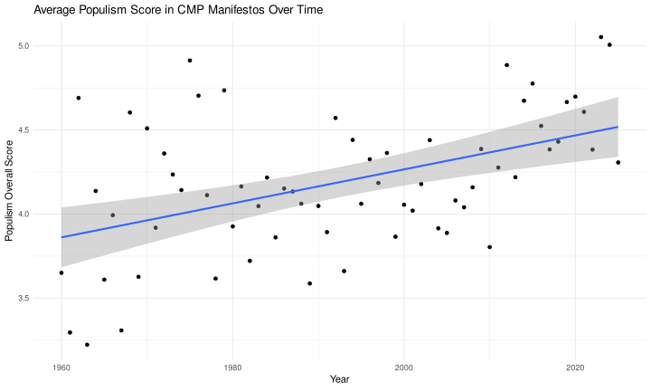
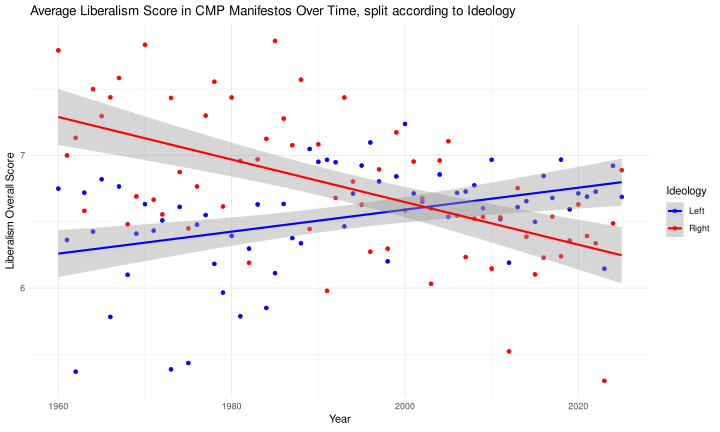
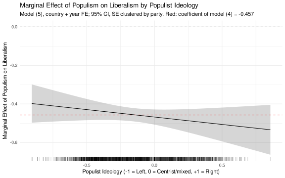
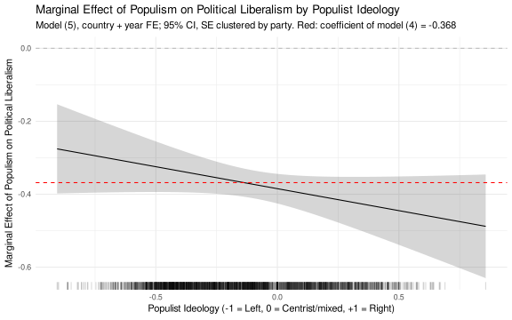
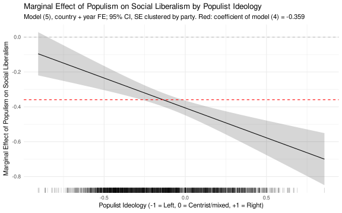
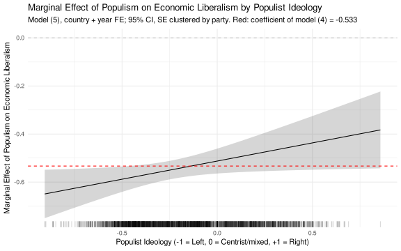
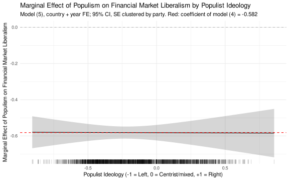
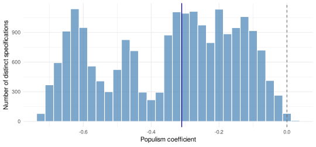

```{r setup, include=FALSE}
suppressPackageStartupMessages({ library(dplyr); library(tidyr); library(knitr); library(jsonlite) })
A <- "assets/milei-question"
rd <- function(f) read.csv(file.path(A, f), stringsAsFactors = FALSE)
f3 <- function(x) formatC(x, format = "f", digits = 3)
f2 <- function(x) formatC(x, format = "f", digits = 2)
pct <- function(x, d = 1) paste0(formatC(100 * x, format = "f", digits = d), "%")
big <- function(x) format(x, big.mark = ",")
stars <- function(p) ifelse(p < 0.01, "***", ifelse(p < 0.05, "**", ifelse(p < 0.1, "*", "")))
LBL <- c(liberalism_overall = "Liberalism (overall)", lib_political = "Political", lib_social = "Social",
         lib_economic = "Economic", lib_financial_market = "Financial markets")
cc  <- rd("41_corpus_counts.csv")
reg <- rd("41_tab4_8_regressions_long.csv") |> filter(vcov == "clparty")
co  <- function(dv, m, term) reg[reg$dv == dv & reg$model == m & reg$term == term, ]
hd  <- rd("42_headline_distribution.csv"); hd <- hd[hd$set == "distinct specs, party SE", ]; hp <- hd[hd$estimand == "pop", ]; hi <- hd[hd$estimand == "inter", ]
nse <- rd("43_nse_rules.csv")
tr  <- rd("41_fig4_5_trend_slopes.csv")
ev  <- rd("44_external_validity.csv") |> filter(llm_measure == "IDEO", external %in% c("rile", "rile_logit", "lrgen", "parlgov_lr"))
rob <- rd("44_interaction_robustness.csv")
src <- fromJSON(file.path(A, "SOURCES.json"))
h1 <- co("liberalism_overall", "m1", "populism_overall")
```

::: {.callout-warning appearance="simple"}
**Working paper.** These are the results of the current data version (v2026a); the paper is
being revised and has not been peer-reviewed. Every number on this page is read from the output
files of the replication chain (`r length(src$files)` files, md5 in `SOURCES.json`); nothing is
typed by hand.
:::

## The question

Javier Milei is widely described as a right-wing populist, and he calls himself a libertarian.
Is that a contradiction, or are right-wing populist parties more liberal than populism in general? We score every party
manifesto of the Manifesto Project corpus with three large language model families on
populism, populist ideology and four kinds of liberalism (political, social, economic,
financial-market), and relate the scores in panel regressions with country and year fixed
effects.

The corpus holds **`r big(cc$manifestos[1])` manifestos** of `r big(cc$parties[1])` parties in
`r cc$countries[1]` countries and `r big(cc$elections[1])` elections, `r cc$first_year[1]`–`r cc$last_year[1]`;
`r big(cc$manifestos[2])` have both a populism and a liberalism score. Every score can be checked
against its evidence on the [manifesto pages](../browse.qmd).

## Populism goes with less liberalism, on every dimension

A one-point higher populism score goes with a liberalism score that is **`r f3(abs(h1$estimate))` points lower**
(standard error `r f3(h1$se)`, clustered by party; N = `r big(h1$nobs)`). The relation holds for
each liberalism dimension and, smaller, within parties over time (party fixed effects).

```{r tab-pop, echo=FALSE}
t1 <- bind_rows(lapply(names(LBL), function(dv) {
  a <- co(dv, "m1", "populism_overall"); b <- co(dv, "m6", "populism_overall")
  data.frame(Outcome = LBL[[dv]],
             `Country + year FE` = paste0(f3(a$estimate), stars(a$p), " (", f3(a$se), ")"),
             N = big(a$nobs),
             `+ party FE` = paste0(f3(b$estimate), stars(b$p), " (", f3(b$se), ")"),
             `N ` = big(b$nobs), check.names = FALSE)
}))
kable(t1, align = "lrrrr", caption = "Coefficient of populism (overall) on liberalism, standard errors clustered by party in parentheses. Columns (1) and (6) of the paper's Tables 4–8.")
```

Populism has risen: `r f3(tr$slope_per_decade[tr$series == "populism_overall" & tr$group == "all"])`
points per decade over all years and
`r f3(tr$slope_per_decade[tr$series == "populism_overall" & tr$group == "all, 1980+"])` since 1980.

::: {.panel-tabset}
### Populism over time
{width=100%}

### Liberalism over time, left and right
{width=100%}
:::

## Right and left: levels differ, the populism effect mostly does not

The ideology measure is the direction of a party's populist ideology,
(right − left) / (right + left + centrist), from −1 (left) to +1 (right). It tracks established
left–right scales closely:

```{r tab-valid, echo=FALSE}
kable(ev |> transmute(`External measure` = external_label, N = big(n), r = f2(r), `Spearman` = f2(rho)),
      align = "lrrr", caption = "Correlation of the ideology direction with external left–right measures.")
```

Right-leaning parties are **less** politically and socially liberal but **more** economically
and financial-market liberal than left-leaning parties with the same populism score. Whether
populism lowers liberalism more on the right than on the left (the interaction) depends on the
dimension: only for social liberalism is the difference robust across ideology measures.

```{r tab-ideo, echo=FALSE}
t2 <- bind_rows(lapply(names(LBL), function(dv) {
  a <- co(dv, "m4", "IDEO"); b <- co(dv, "m5", "populism_overall:IDEO")
  data.frame(Outcome = LBL[[dv]],
             `Ideology direction (level)` = paste0(f3(a$estimate), stars(a$p), " (", f3(a$se), ")"),
             `Populism × ideology` = paste0(f3(b$estimate), stars(b$p), " (", f3(b$se), ")"),
             `Across 5 ideology measures` = rob$verdict[match(dv, rob$dv)], check.names = FALSE)
}))
kable(t2, align = "lrrl", caption = "Columns (4) and (5) of Tables 4–8: level of the ideology direction controlling for populism, and the interaction; standard errors clustered by party. Last column: interaction re-estimated with CMP rile, its logit version, CHES lrgen and ParlGov instead of the LLM measure.")
```

::: {.panel-tabset}
### Overall
{width=100%}

### Political
{width=100%}

### Social
{width=100%}

### Economic
{width=100%}

### Financial markets
{width=100%}
:::

The answer to the Milei question: right-leaning populists start from a more pro-market
position, but the more populist a manifesto, the less economically liberal it is, on the right
as on the left.

## How much do the analytic choices matter?

Measuring populism with language models involves many defensible choices: which models, how
chunk scores are aggregated, which evidence counts, which sample, which fixed effects. We
estimate the populism coefficient for every combination:
**`r big(hp$n)` distinct specifications**, of which `r pct(hp$share_sig_neg)` are significantly
negative and none is significantly positive (median `r f3(hp$median)`, 95% of estimates between
`r f3(hp$p2.5)` and `r f3(hp$p97.5)`).

```{r tab-nse, echo=FALSE}
nl <- c(measure = "Measurement choices only", outcome = "Outcome fixed, all analytic choices", all = "All, five outcomes")
t3 <- nse |> filter(estimand == "pop") |> mutate(pool = factor(pool, names(nl))) |> arrange(pool) |>
  transmute(`Pool of specifications` = nl[as.character(pool)], Specifications = big(n_specs),
            `Non-standard error` = f3(nse_sd), `Headline SE` = f3(base_se),
            `Combined SE` = f3(se_total), `t (combined)` = f2(t_total))
kable(t3, align = "lrrrrr", caption = paste0("Non-standard errors of the headline coefficient (", f3(h1$estimate), "): the standard deviation of the estimate across specifications, and the combined standard error √(SE² + NSE²)."))
```

::: {.panel-tabset}
### Specification curve
{width=100%}

### Distribution
{width=100%}
:::

## Data and replication

- **Scores and evidence:** [browse all manifestos](../browse.qmd), each with per-model scores and
  the evidence quotes that entered them.
- **Download:** [analysis-ready scores](../download.qmd) (one row per manifesto, CC-BY 4.0).
- **Method:** [how the scores are built](../methodology.qmd).
- **Paper:** Rode, M. and S. Stöckl (2026), *The Milei question, or: How liberal are right-wing
  populist parties?*, working paper.
