```{r setup, include=FALSE}
suppressPackageStartupMessages({ library(dplyr); library(tidyr); library(knitr); library(jsonlite) })
A <- "assets/milei-question"
rd <- function(f) read.csv(file.path(A, f), stringsAsFactors = FALSE)
f3 <- function(x) formatC(x, format = "f", digits = 3)
f2 <- function(x) formatC(x, format = "f", digits = 2)
pct <- function(x, d = 1) paste0(formatC(100 * x, format = "f", digits = d), "%")
big <- function(x) format(x, big.mark = ",")
stars <- function(p) ifelse(p < 0.01, "***", ifelse(p < 0.05, "**", ifelse(p < 0.1, "*", "")))
LBL <- c(liberalism_overall = "Liberalism (overall)", lib_political = "Political", lib_social = "Social",
         lib_economic = "Economic", lib_financial_market = "Financial markets")
cc  <- rd("41_corpus_counts.csv")
reg <- rd("41_tab4_8_regressions_long.csv") |> filter(vcov == "clparty")
co  <- function(dv, m, term) reg[reg$dv == dv & reg$model == m & reg$term == term, ]
hd  <- rd("42_headline_distribution.csv"); hd <- hd[hd$set == "distinct specs, party SE", ]; hp <- hd[hd$estimand == "pop", ]; hi <- hd[hd$estimand == "inter", ]
nse <- rd("43_nse_rules.csv")
tr  <- rd("41_fig4_5_trend_slopes.csv")
ev  <- rd("44_external_validity.csv") |> filter(llm_measure == "IDEO", external %in% c("rile", "rile_logit", "lrgen", "parlgov_lr"))
rob <- rd("44_interaction_robustness.csv")
src <- fromJSON(file.path(A, "SOURCES.json"))
h1 <- co("liberalism_overall", "m1", "populism_overall")
lla <- rd("53_lla_table.csv")
gm  <- rd("53_group_means.csv")
pin <- rd("53_prediction_intervals.csv") |> filter(doc_id %in% lla$doc_id)
gmv <- function(reg, sub, out) gm$mean[gm$region == reg & gm$subgroup == sub & gm$outcome == out]
```

::: {.callout-warning appearance="simple"}
**Working paper**<span class="paper-status"></span>. These are the results of the current data
version (v2026a). Every number on this page is read from the output
files of the replication chain (`r length(src$files)` files, md5 in `SOURCES.json`); nothing is
typed by hand.
:::

## The question

Javier Milei is widely described as a right-wing populist, and he calls himself a libertarian.
Is that a contradiction, or are right-wing populist parties more liberal than populism in general? We score every party
manifesto of the Manifesto Project corpus with three large language model families on
populism, populist ideology and four kinds of liberalism (political, social, economic,
financial-market), and relate the scores in panel regressions with country and year fixed
effects.

The corpus holds **`r big(cc$manifestos[1])` manifestos** of `r big(cc$parties[1])` parties in
`r cc$countries[1]` countries and `r big(cc$elections[1])` elections, `r cc$first_year[1]`–`r cc$last_year[1]`;
`r big(cc$manifestos[2])` have both a populism and a liberalism score. Every score can be checked
against its evidence on the [manifesto pages](../browse.qmd).

## Populism goes with less liberalism, on every dimension

A one-point higher populism score goes with a liberalism score that is **`r f3(abs(h1$estimate))` points lower**
(standard error `r f3(h1$se)`, clustered by party; N = `r big(h1$nobs)`). The relation holds for
each liberalism dimension and, smaller, within parties over time (party fixed effects).

```{r tab-pop, echo=FALSE}
t1 <- bind_rows(lapply(names(LBL), function(dv) {
  a <- co(dv, "m1", "populism_overall"); b <- co(dv, "m6", "populism_overall")
  data.frame(Outcome = LBL[[dv]],
             `Country + year FE` = paste0(f3(a$estimate), stars(a$p), " (", f3(a$se), ")"),
             N = big(a$nobs),
             `+ party FE` = paste0(f3(b$estimate), stars(b$p), " (", f3(b$se), ")"),
             `N ` = big(b$nobs), check.names = FALSE)
}))
kable(t1, align = "lrrrr", caption = "Coefficient of populism (overall) on liberalism, standard errors clustered by party in parentheses. Columns (1) and (6) of the paper's Tables 4–8.")
```

Populism has risen: `r f3(tr$slope_per_decade[tr$series == "populism_overall" & tr$group == "all"])`
points per decade over all years and
`r f3(tr$slope_per_decade[tr$series == "populism_overall" & tr$group == "all, 1980+"])` since 1980.

::: {.panel-tabset}
### Populism over time
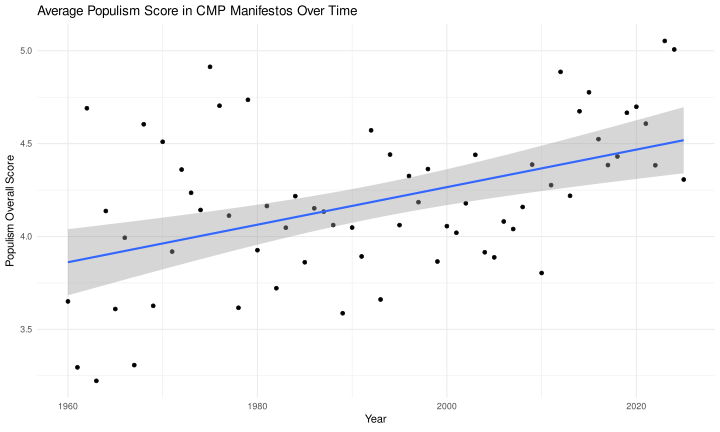{width=100%}

### Liberalism over time, left and right
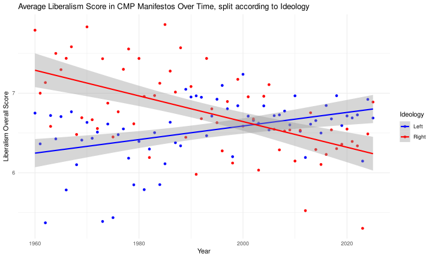{width=100%}
:::

## Right and left: levels differ, the populism effect mostly does not

The ideology measure is the direction of a party's populist ideology,
(right − left) / (right + left), from −1 (left) to +1 (right). It tracks established
left–right scales closely:

```{r tab-valid, echo=FALSE}
kable(ev |> transmute(`External measure` = external_label, N = big(n), r = f2(r), `Spearman` = f2(rho)),
      align = "lrrr", caption = "Correlation of the ideology direction with external left–right measures.")
```

Right-leaning parties are **less** politically and socially liberal but **more** economically
and financial-market liberal than left-leaning parties with the same populism score. Whether
populism lowers liberalism more on the right than on the left (the interaction) depends on the
dimension: only for social liberalism is the difference robust across ideology measures.

```{r tab-ideo, echo=FALSE}
t2 <- bind_rows(lapply(names(LBL), function(dv) {
  a <- co(dv, "m4", "IDEO"); b <- co(dv, "m5", "populism_overall:IDEO")
  data.frame(Outcome = LBL[[dv]],
             `Ideology direction (level)` = paste0(f3(a$estimate), stars(a$p), " (", f3(a$se), ")"),
             `Populism × ideology` = paste0(f3(b$estimate), stars(b$p), " (", f3(b$se), ")"),
             `Across 5 ideology measures` = rob$verdict[match(dv, rob$dv)], check.names = FALSE)
}))
kable(t2, align = "lrrl", caption = "Columns (4) and (5) of Tables 4–8: level of the ideology direction controlling for populism, and the interaction; standard errors clustered by party. Last column: interaction re-estimated with CMP rile, its logit version, CHES lrgen and ParlGov instead of the LLM measure.")
```

::: {.panel-tabset}
### Overall
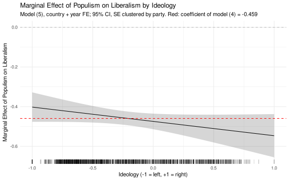{width=100%}

### Political
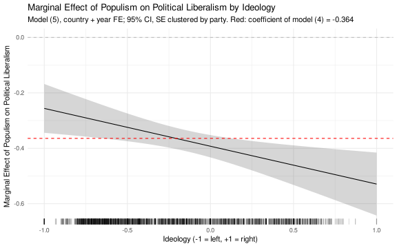{width=100%}

### Social
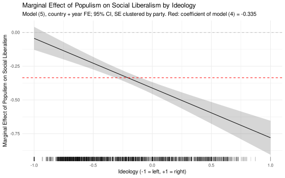{width=100%}

### Economic
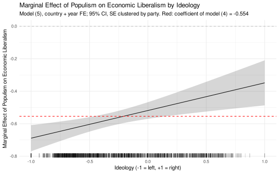{width=100%}

### Financial markets
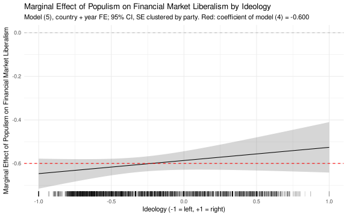{width=100%}
:::

The answer to the Milei question: right-leaning populists start from a more pro-market
position, but the more populist a manifesto, the less economically liberal it is, on the right
as on the left.

## La Libertad Avanza: the outlier, but only in economics

Milei's party entered national politics in 2021, after the last Argentine election in the
Manifesto Project corpus. We therefore scored the platforms that Argentine parties filed with the
Cámara Nacional Electoral for the 2021, 2023 and 2025 elections, `r nrow(lla)` of them by
*La Libertad Avanza*, out of sample with the identical pipeline and aggregation rule. They are not
part of the corpus above.

```{r tab-lla, echo=FALSE}
lab <- c(AR2021G_CF_LLA = "LLA 2021, Capital Federal", AR2023P_ON_LLA = "LLA 2023, national (primaries)",
         AR2023G_ON_LLA = "LLA 2023, national (general)", AR2025G_BA_LLA = "LLA 2025, Buenos Aires",
         AR2025G_CF_LLA = "LLA 2025, Capital Federal")
cols <- c("populism_overall", "ideology", "lib_political", "lib_social", "lib_economic", "lib_financial_market", "liberalism_overall")
t4 <- lla |> transmute(Platform = unname(lab[doc_id]), Populism = f2(populism_overall), Ideology = f2(ideology),
  Political = f2(lib_political), Social = f2(lib_social), Economic = f2(lib_economic),
  Financial = f2(lib_financial_market), Overall = f2(liberalism_overall))
refs <- list(c("World", "all", "World: all parties"), c("World", "right_populist", "World: right-wing populist"),
             c("Latin America", "right_populist", "Latin America: right-wing populist"))
o2 <- c("populism_overall", "IDEO", "lib_political", "lib_social", "lib_economic", "lib_financial_market", "liberalism_overall")
t4r <- do.call(rbind, lapply(refs, function(r) { v <- vapply(o2, function(o) gmv(r[1], r[2], o), 0)
  data.frame(Platform = r[3], Populism = f2(v[1]), Ideology = f2(v[2]), Political = f2(v[3]), Social = f2(v[4]),
             Economic = f2(v[5]), Financial = f2(v[6]), Overall = f2(v[7])) }))
kable(rbind(t4, t4r), align = "lrrrrrrr", row.names = FALSE,
      caption = "Scores of the five La Libertad Avanza platforms (0–10; ideology −1 left to +1 right) and the means of the corpus manifestos. Right-wing populist = ideology above zero and populism above the corpus median.")
```

Three patterns stand out. First, by our measures *La Libertad Avanza* is a right-wing populist
party, and increasingly so: its populism score rises from `r f2(min(lla$populism_overall))` in
2021 to `r f2(max(lla$populism_overall))` in 2025, against `r f2(gmv("World", "right_populist", "populism_overall"))`
for right-wing populist manifestos worldwide. Second, its economic liberalism is close to the
ceiling at every election (`r f2(min(lla$lib_economic))` to `r f2(max(lla$lib_economic))`, against
`r f2(gmv("World", "right_populist", "lib_economic"))` for right-wing populists worldwide);
`r sum(pin$outcome == "lib_economic" & pin$outside_pi95)` of the five platforms lie above the 95%
prediction interval of the model on economic liberalism. Third, in the social dimension it is a
typical right-wing populist: its score falls from `r f2(lla$lib_social[lla$doc_id == "AR2021G_CF_LLA"])`
in 2021 to `r f2(lla$lib_social[lla$doc_id == "AR2023G_ON_LLA"])` in 2023 and stays there. Milei's
movement is the outlier the title alludes to, but only on economic and financial-market liberalism.

::: {.panel-tabset}
### Against the averages
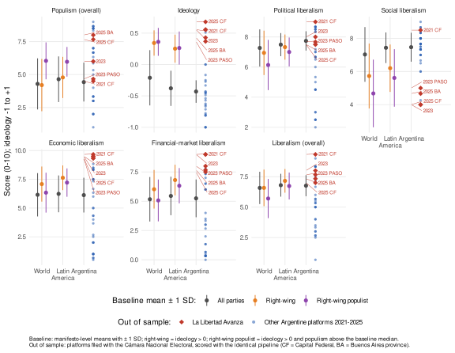{width=100%}

### Scored vs. predicted
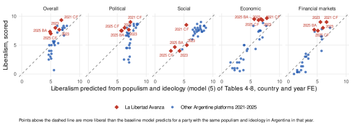{width=100%}

### Populism and liberalism
{width=100%}

### Over time
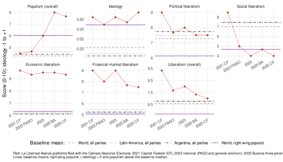{width=100%}
:::

## How much do the analytic choices matter?

Measuring populism with language models involves many defensible choices: which models, how
chunk scores are aggregated, which evidence counts, which sample, which fixed effects. We
estimate the populism coefficient for every combination:
**`r big(hp$n)` distinct specifications**, of which `r pct(hp$share_sig_neg)` are significantly
negative and none is significantly positive (median `r f3(hp$median)`, 95% of estimates between
`r f3(hp$p2.5)` and `r f3(hp$p97.5)`).

```{r tab-nse, echo=FALSE}
nl <- c(measure = "Measurement choices only", outcome = "Outcome fixed, all analytic choices", all = "All, five outcomes")
t3 <- nse |> filter(estimand == "pop") |> mutate(pool = factor(pool, names(nl))) |> arrange(pool) |>
  transmute(`Pool of specifications` = nl[as.character(pool)], Specifications = big(n_specs),
            `Non-standard error` = f3(nse_sd), `Headline SE` = f3(base_se),
            `Combined SE` = f3(se_total), `t (combined)` = f2(t_total))
kable(t3, align = "lrrrrr", caption = paste0("Non-standard errors of the headline coefficient (", f3(h1$estimate), "): the standard deviation of the estimate across specifications, and the combined standard error √(SE² + NSE²)."))
```

::: {.panel-tabset}
### Specification curve
{width=100%}

### Distribution
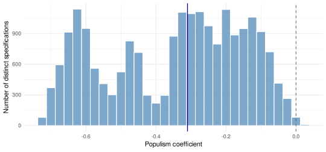{width=100%}
:::

## Data and replication

- **Scores and evidence:** [browse all manifestos](../browse.qmd), each with per-model scores and
  the evidence quotes that entered them.
- **Download:** [analysis-ready scores](../download.qmd) (one row per manifesto, CC-BY 4.0).
- **Method:** [how the scores are built](../methodology.qmd).
- **Replication:** the [replication package](https://github.com/sstoeckl/populism-llm-replication) regenerates every table, figure and number
  of the paper, including those on this page, with one command; its public inputs are also on
  [Hugging Face](https://huggingface.co/datasets/sstoeckl/populism-llm-replication).
- **Paper:** [Martin Rode](https://sites.google.com/unav.es/martin-rode/home) and [Sebastian Stöckl](http://www.sebastianstoeckl.com) (2026), [*The Milei question, or: How
  liberal are right-wing populist parties? A measurement approach using large language models*](https://ssrn.com/abstract=7758858),
  working paper, SSRN.
